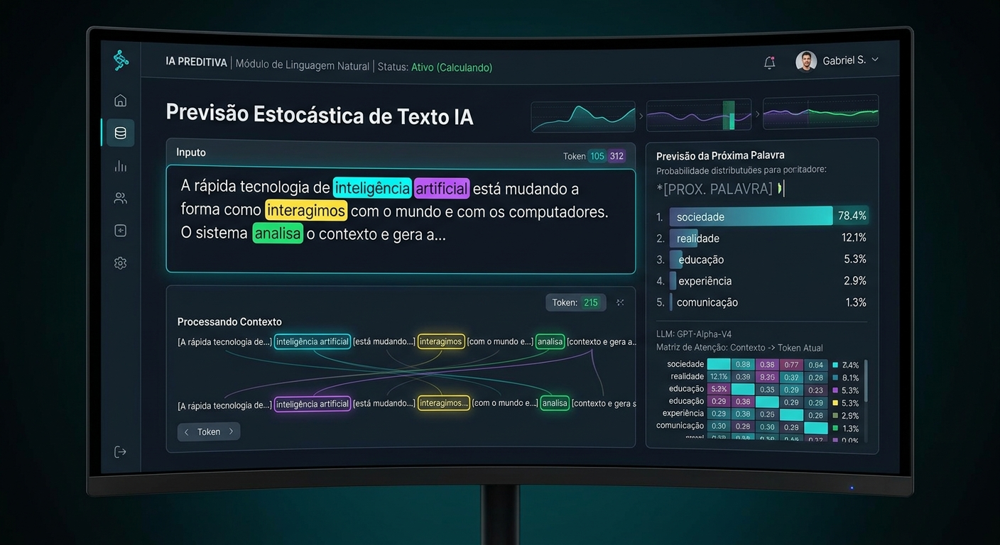
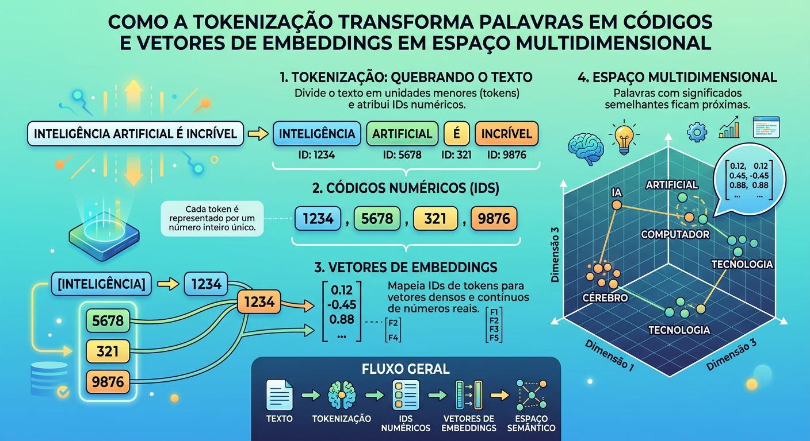
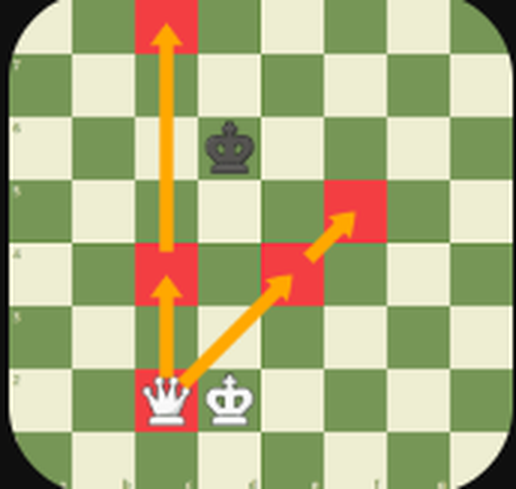
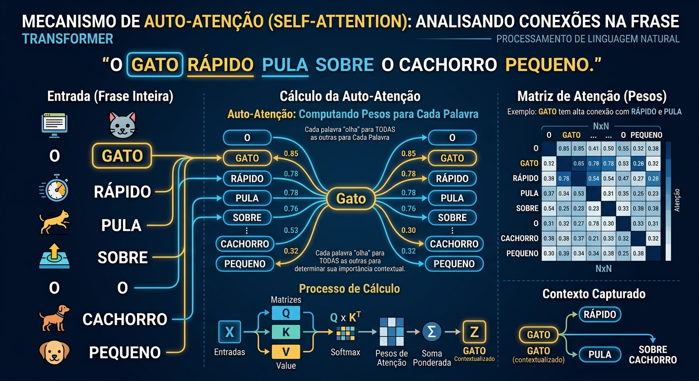
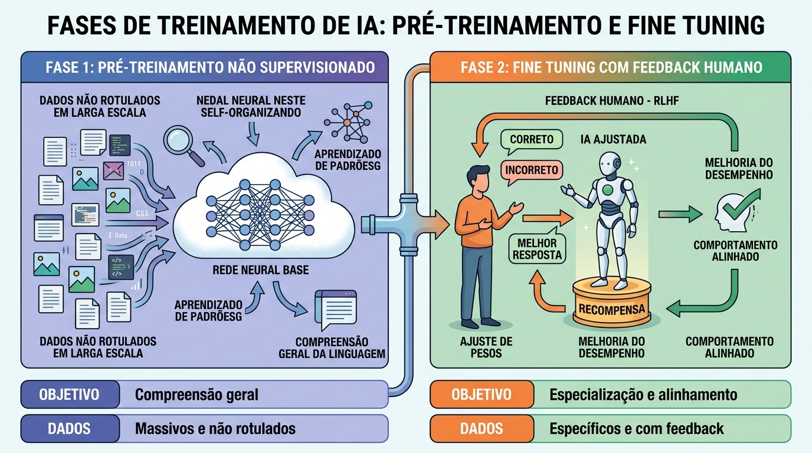

# Guia Explicativo de LLMs (Large Language Models)

Os LLMs são modelos de Inteligência Artificial especializados no processamento e na geração de linguagem natural. Pertencem ao subcampo do **Deep Learning (Aprendizado Profundo)** e utilizam redes neurais massivas, predominantemente baseadas na arquitetura **Transformer**, introduzida pelo Google em 2017 no artigo *"Attention Is All You Need"*.

---

## LLMs

### Escala gigantesca (Large Language)

O termo **"Grande" (Large)** refere-se a duas dimensões:

- **Parâmetros:** a rede neural pode ter de bilhões a trilhões de parâmetros.
- **Dados de treinamento:** um volume colossal de texto, incluindo livros, artigos científicos, código de programação e páginas inteiras da web.

*Grandes volumes de dados da internet (notícias, artigos, livros, código) sendo processados em um cluster de treinamento.*

### Previsão estatística avançada (Advanced Statistical Forecasting)

Em essência, um LLM é uma máquina sofisticada de **prever a próxima palavra (ou token)**. Dado um texto de entrada (*prompt*), ele calcula probabilisticamente qual fragmento deve vir a seguir para formar uma resposta coerente, útil e contextualizada. Funciona como um corretor ortográfico ultrassofisticado.

*Para o contexto informado, o modelo atribui uma probabilidade a cada palavra candidata e escolhe a mais provável (aqui, "sociedade", com 78,4%).*

---

## Funcionamento interno

### Tokenização e Embeddings (a linguagem dos números)

Computadores não entendem palavras diretamente. Por isso:

1. O texto é dividido em **tokens**, que podem ser palavras inteiras, sílabas ou partes de palavras.
2. Cada token recebe um **código numérico** (ID).
3. Cada ID é convertido em um **vetor (embedding)**: um ponto em um espaço multidimensional onde **palavras com significados semelhantes ficam próximas**.

*Fluxo completo: texto, tokenização, IDs numéricos, vetores de embeddings e espaço semântico.*

**Exemplo:** "rei" e "rainha" ficam geometricamente próximos no espaço vetorial, assim como o rei e a dama ficam lado a lado em um tabuleiro de xadrez.

*Analogia geométrica: no tabuleiro, rei e dama ocupam casas vizinhas, como "rei" e "rainha" no espaço de embeddings.*

### Mecanismo de Atenção (Self-Attention)

Esta é a grande inovação da arquitetura **Transformer**. Modelos antigos liam o texto palavra por palavra, de forma linear. O Transformer analisa **a frase inteira em paralelo** e calcula o **peso de atenção** que cada palavra deve dar às outras, capturando o contexto exato.

*Cada palavra "olha" para todas as outras e recebe um peso de atenção, organizado em uma matriz N×N. O cálculo envolve as matrizes Q (query), K (key) e V (value), seguidas de softmax e soma ponderada.*

**Exemplo 1 (desambiguação):** na frase *"O banco de areia era bonito, mas o banco fechou cedo"*, o modelo usa o contexto ao redor para entender que o primeiro "banco" se refere à natureza e o segundo a uma instituição financeira.

**Exemplo 2 (Sandman):** ao ler *"O homem de areia fez parte do filme A Origem dos Guardiões"*, o mecanismo foca nos termos correlatos (*filme*, *Guardiões*) para direcionar ao personagem correto. O mesmo nome, "Sandman", pode apontar para personagens bem diferentes dependendo do contexto:

  
  
  

*Da esquerda para a direita: "A Origem dos Guardiões", série The Sandman (Netflix) e Homem-Areia (Homem-Aranha). É o contexto da frase que define qual deles está sendo citado.*

### Fases de treinamento

- **Pré-treinamento (Unsupervised Learning):** o modelo lê terabytes de dados não estruturados da internet e aprende gramática, fatos sobre o mundo, lógica e estruturas de linguagem apenas tentando adivinhar a palavra seguinte.
- **Fine-Tuning e Alinhamento (RLHF, Reinforcement Learning from Human Feedback):** ajustes finos com supervisão humana ensinam o modelo a ser útil, seguro, seguir instruções e evitar respostas tóxicas ou alucinações.

*Fase 1 (pré-treinamento não supervisionado, com compreensão geral da linguagem) e Fase 2 (fine-tuning com feedback humano, com especialização e alinhamento).*

---

## Aplicações

Os LLMs são **tecnologias de uso geral (general-purpose technologies)**, aplicadas sempre que há necessidade de entender, transformar, resumir ou gerar texto e código.

- **Desenvolvimento de Software e Engenharia:** geração de código em dezenas de linguagens (Python, JavaScript, C++ etc.), refatoração, documentação automática e detecção de bugs.
- **Análise e Síntese de Dados Textuais:** resumo automático de relatórios extensos, extração de informações-chave de contratos e classificação de sentimentos em feedbacks de clientes.
- **Criação de Conteúdo e Tradução:** redação de artigos, textos de marketing, e-mails profissionais e tradução de alta fidelidade com preservação de tom e contexto cultural.
- **Assistentes Conversacionais e Automação:** chatbots avançados de atendimento integrados a bases de conhecimento internas (sistemas **RAG**, Retrieval-Augmented Generation).
- **Agentes de IA:** sistemas autônomos em que o LLM atua como "cérebro" central: planeja tarefas, usa ferramentas (calculadoras, APIs de clima) e resolve problemas complexos de ponta a ponta.