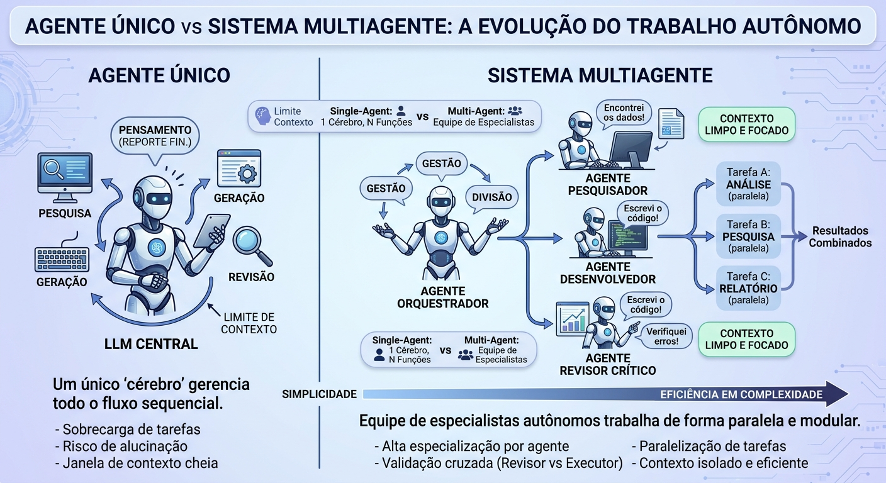

# Agente Único vs. Sistemas Multi-Agente

Existem duas formas principais de organizar agentes de IA: um único LLM que faz todo o trabalho, ou uma equipe de agentes especializados que cooperam. Este guia explica cada uma, compara as duas e indica quando escolher cada abordagem.

Pense em uma redação de jornal: o **agente único** é um freelancer que pesquisa, escreve e revisa sozinho, e o **sistema multi-agente** é uma equipe com pesquisador, redator e revisor.

<p align="center"></p>

*À esquerda, um único cérebro gerencia todo o fluxo. À direita, um orquestrador distribui o trabalho entre especialistas.*

## Sumário

1. [Agente Único (Single-Agent System)](#1-agente-único-single-agent-system)
   - [1.1 Como funciona na prática](#11-como-funciona-na-prática)
   - [1.2 Vantagens e limitações](#12-vantagens-e-limitações)
2. [Sistemas Multi-Agente (Multi-Agent Systems, MAS)](#2-sistemas-multi-agente-multi-agent-systems-mas)
   - [2.1 Como funciona na prática](#21-como-funciona-na-prática)
   - [2.2 Vantagens e limitações](#22-vantagens-e-limitações)
3. [Tabela comparativa](#3-tabela-comparativa)
4. [Quando escolher cada um](#4-quando-escolher-cada-um)

## 1. Agente Único (Single-Agent System)

Um agente único é um sistema centralizado em que **um único LLM** desempenha todas as funções do fluxo de trabalho. Ele recebe o objetivo inicial, planeja a execução, escolhe quais ferramentas usar (APIs, calculadoras, buscas), executa as etapas e revisa o resultado final por conta própria.

```
[Usuário] ──► [Agente Único (LLM)] ──► (Analisa + Pesquisa + Redige + Revisa) ──► [Resposta Final]
```

### 1.1 Como funciona na prática

Se você pedir a um agente único: *"Analise os dados financeiros da minha empresa e crie um relatório executivo"*, ele fará tudo em sequência, em uma única chamada ou loop de execução:

1. Lê a base de dados.
2. Faz os cálculos necessários.
3. Rascunha o texto do relatório.
4. Trata a formatação e entrega a resposta final.

### 1.2 Vantagens e limitações

| Vantagem | Descrição |
|---|---|
| **Simplicidade e baixo custo** | Menos chamadas de API e menor consumo de tokens |
| **Fácil depuração** | Se houver um erro, é fácil rastrear o caminho exato do raciocínio em um único histórico de execução |
| **Menor latência** | Mais rápido para tarefas diretas ou sequenciais simples |

| Limitação | Descrição |
|---|---|
| **Sobrecarga de contexto (*Context Drift*)** | Em tarefas muito longas, o prompt do agente fica sobrecarregado com dados de pesquisa, regras e erros intermediários, e ele perde o foco nas instruções originais |
| **Efeito "tudo em um"** | Pedir ao mesmo modelo para ser programador sênior, crítico rígido e designer visual no mesmo prompt costuma reduzir a qualidade geral |

## 2. Sistemas Multi-Agente (Multi-Agent Systems, MAS)

Um sistema multi-agente **descentraliza** a resolução de problemas em vários agentes autônomos e especializados. Cada agente tem a sua própria persona, o seu próprio prompt do sistema (*System Prompt*), um conjunto restrito de ferramentas e uma área de atuação. Os agentes interagem trocando mensagens, dados ou feedback para construir a solução.

```
                               ┌──► [Agente Pesquisador] (Busca dados) ──┐
[Usuário] ──► [Orquestrador] ──┤                                         ├──► [Agente Revisor] ──► [Entrega Final]
                               └──► [Agente Redator]     (Escreve texto) ┘
```

### 2.1 Como funciona na prática

No mesmo exemplo do relatório financeiro, um sistema multi-agente funciona assim:

| Agente | O que faz |
|---|---|
| **Orquestrador / Gerente** | Recebe a tarefa, divide em subtarefas e atribui responsabilidades |
| **Analista de Dados** | Acessa o banco de dados, executa scripts de cálculo e extrai os números principais, passando os dados estruturados ao próximo agente |
| **Redator** | Pega os dados brutos e escreve o relatório em linguagem clara |
| **Crítico / Revisor** | Compara o texto do Redator com os dados do Analista. Se encontrar inconsistências, rejeita o texto e pede ao Redator que corrija antes da entrega final |

### 2.2 Vantagens e limitações

| Vantagem | Descrição |
|---|---|
| **Separação de responsabilidades** (*Separation of Concerns*) | Cada agente opera em uma janela de contexto limpa e focada em uma única especialidade |
| **Paralelização** | Agentes diferentes podem realizar pesquisas ou tarefas independentes ao mesmo tempo, reduzindo o tempo total |
| **Aprimoramento por validação adversarial** | Um agente revisor dedicado cria um filtro natural contra erros e alucinações |

| Limitação | Descrição |
|---|---|
| **Custo e carga de tokens** | Exige várias chamadas aos LLMs para a comunicação entre os agentes, e o custo por tarefa pode ser várias vezes maior |
| **Loops infinitos e complexidade** | Se não forem bem programados, os agentes podem entrar em ciclos sem fim de crítica e refatoração, aumentando a latência e o custo |

## 3. Tabela comparativa

| Critério | Agente Único (Single-Agent) | Sistema Multi-Agente (Multi-Agent) |
|---|---|---|
| **Arquitetura** | Monolítica (1 modelo resolve tudo) | Modular e distribuída (especialistas) |
| **Complexidade de código** | Baixa a média | Alta (requer orquestração e gerenciamento de estado) |
| **Consumo de tokens / custo** | Menor | Maior (devido ao fluxo de mensagens entre agentes) |
| **Qualidade em tarefas extensas** | Pode degradar devido à poluição de contexto | Tende a se manter alta pelo foco isolado de cada agente |
| **Evolução e manutenção** | Alterar o prompt pode desalinhar outras funções | Alterar um agente não interfere nos demais |

## 4. Quando escolher cada um

| Escolha | Quando | Exemplos |
|---|---|---|
| **Agente Único** | O fluxo é predominantemente linear, exige baixa latência e tem orçamento controlado | Assistentes de suporte rápido, ferramentas de busca e resumo de documentos pontuais |
| **Sistema Multi-Agente** | O fluxo envolve etapas complexas com validação rigorosa | Geração e execução automática de código com testes, criação colaborativa de conteúdo técnico, auditoria de dados com múltiplos papéis |