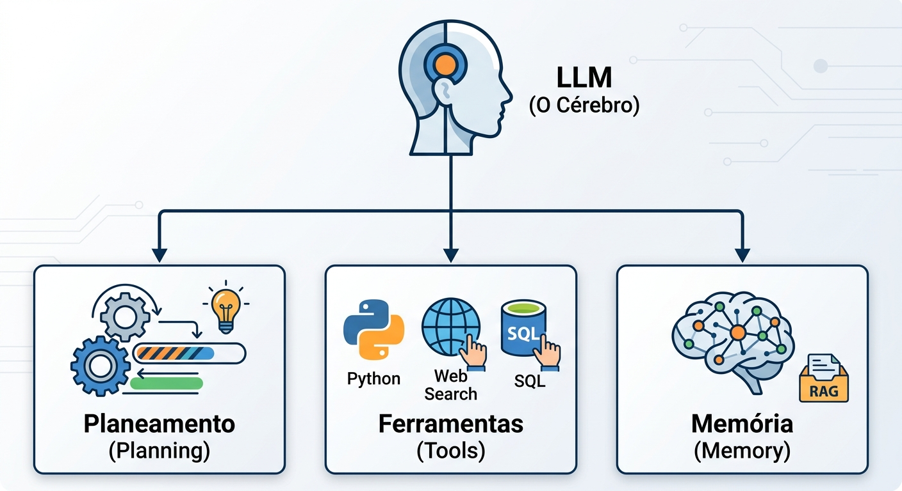
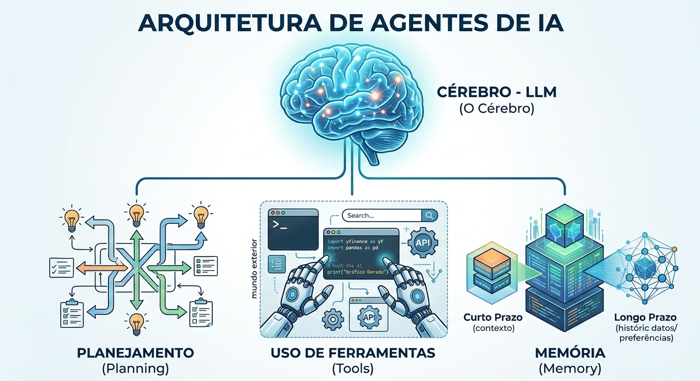
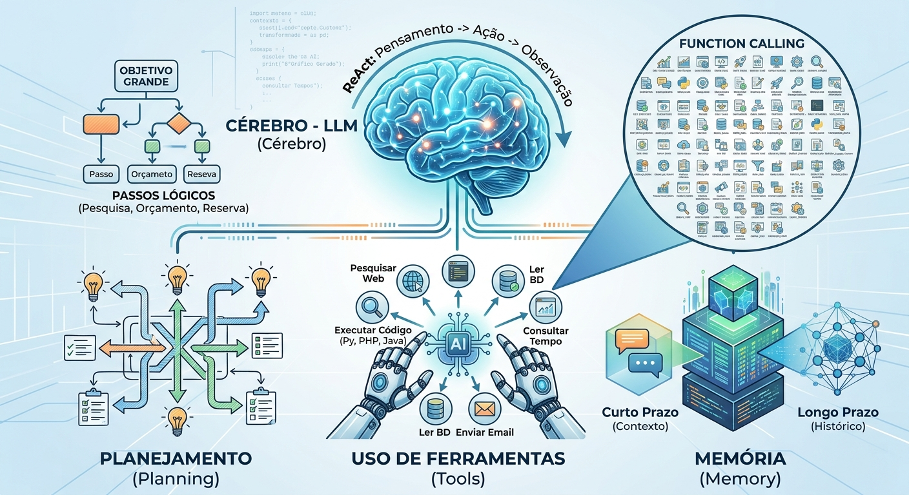

# Funcionamento de Agentes de IA

Agentes de IA são sistemas em que um LLM planeja, usa ferramentas e guarda memória para resolver tarefas do início ao fim. Este guia explica os pilares de um agente e o loop que o faz funcionar.

## Sumário

1. [Analogia com o corpo humano](#1-analogia-com-o-corpo-humano)
2. [Pilares](#2-pilares)
   - [2.1 Cérebro (LLM)](#21-cérebro-llm)
   - [2.2 Planejamento (Planning)](#22-planejamento-planning)
   - [2.3 Uso de ferramentas (Tools e Function Calling)](#23-uso-de-ferramentas-tools-e-function-calling)
   - [2.4 Memória (Memory)](#24-memória-memory)
3. [Exemplo prático: chatbot vs. agente de IA](#3-exemplo-prático-chatbot-vs-agente-de-ia)
4. [O loop de funcionamento (ReAct)](#4-o-loop-de-funcionamento-react)
5. [Conclusão](#5-conclusão)

## 1. Analogia com o corpo humano

Veja a LLM como o **cérebro**. Esse corpo também possui **mãos**, **memória** e **capacidade de raciocínio**:

| Parte do corpo | Componente do agente |
|---|---|
| **Cérebro** | LLM |
| **Capacidade de raciocínio** | Planejamento (Planning) |
| **Mãos** | Ferramentas (Tools) |
| **Memória** | Memória (Memory) |

<p align="center"></p>

*A LLM (o cérebro) se conecta aos três blocos que formam o agente: Planejamento, Ferramentas e Memória.*

## 2. Pilares

Cada pilar do agente é um item ligado ao cérebro, e não uma coluna literal.

<p align="center"></p>

*Arquitetura de um agente de IA: o cérebro (LLM) conectado a Planejamento, Uso de ferramentas e Memória.*

### 2.1 Cérebro (LLM)

O modelo de IA que processa a intenção do usuário, analisa o que precisa ser feito e toma as decisões.

### 2.2 Planejamento (Planning)

É a capacidade de decompor um objetivo grande em pequenos passos lógicos.

**Exemplo:** para agendar uma viagem, o agente precisa pesquisar voos, calcular o orçamento e reservar.

### 2.3 Uso de ferramentas (Tools e Function Calling)

O agente consegue interagir com o "mundo exterior": executar código em Python, PHP e Java, pesquisar na web, ler bancos de dados, enviar e-mails e muito mais.

<p align="center"></p>

*O cérebro escolhe, entre muitas funções disponíveis (function calling), qual ferramenta usar em cada passo.*

A lista completa, com **130 exemplos** organizados em 13 categorias, está em [function-calling-lista-completa.md](function-calling-lista-completa.md).

### 2.4 Memória (Memory)

| Tipo | O que guarda |
|---|---|
| **Curto prazo** | O contexto imediato da conversa |
| **Longo prazo** | Preferências do usuário e histórico de ações passadas (geralmente com bancos de dados vetoriais/RAG) |

## 3. Exemplo prático: chatbot vs. agente de IA

Imagine o pedido: *"Descubra o preço das ações da Apple hoje e crie um gráfico com o resumo dos últimos 5 dias em um arquivo PDF."*

<p align="center"></p>

*À esquerda, o chatbot tradicional trava no pedido. À direita, o agente cumpre cada etapa por conta própria.*

**Chatbot tradicional:** responderia algo como *"Não consigo criar arquivos PDF diretamente, mas posso lhe dizer o valor atual da ação se você me der mais detalhes..."*

**Agente de IA (loop autônomo):**

| Ação | O que o agente faz |
|---|---|
| **1** | Conecta-se à API da bolsa de valores e lê o histórico dos preços |
| **2** | Escreve um script em Python para gerar o gráfico com os dados |
| **3** | Executa o código Python em um ambiente seguro |
| **4** | Gera o documento PDF final e envia o link ou o arquivo ao usuário |

## 4. O loop de funcionamento (ReAct)

**ReAct** vem de *Reasoning + Acting* (Raciocinar + Agir). O agente repete o ciclo abaixo até resolver o problema:

```
Pensamento  →  Ação  →  Observação  →  (volta ao Pensamento)
Thought     →  Action →  Observation
```

| Etapa | Em inglês | O que acontece |
|---|---|---|
| **Pensamento** | *Thought* | Analisa a situação atual e decide o próximo passo |
| **Ação** | *Action* | Chama uma ferramenta externa, se necessário |
| **Observação** | *Observation* | Valida se o dado externo encontrado resolve o problema ou se deve continuar procurando |

## 5. Conclusão

Os agentes de IA representam a transição da Inteligência Artificial de um assistente passivo para um trabalhador autônomo. Eles usam engenharia de contexto, RAG e chamadas de funções (function calling) para resolver problemas complexos do início ao fim, sem intervenção humana a cada passo.