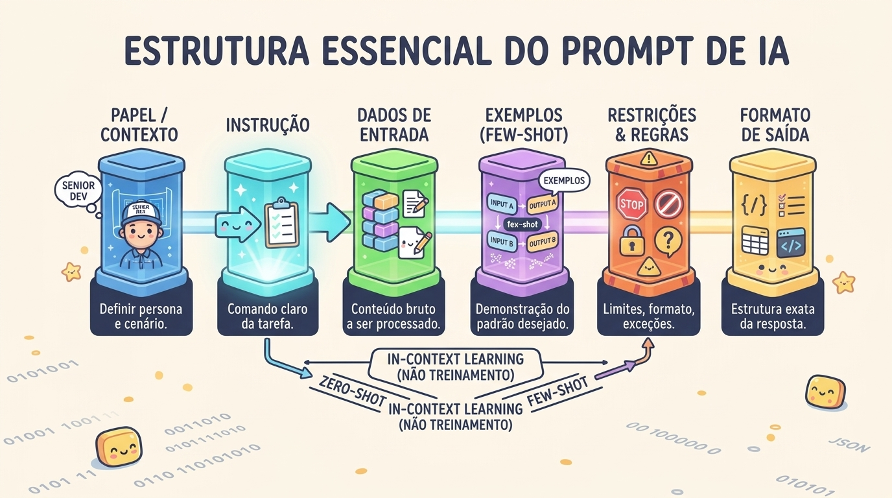

# Estrutura de Prompts: Zero-shot, Few-shot e Componentes

Este guia explica os componentes essenciais de um prompt para modelos de linguagem, a diferença entre zero-shot e few-shot prompting e por que essas técnicas são chamadas de *in-context learning*.

## Sumário

1. [Estrutura essencial do prompt](#1-estrutura-essencial-do-prompt)
2. [In-context learning x fine-tuning](#2-in-context-learning-x-fine-tuning)
3. [Zero-shot prompting](#3-zero-shot-prompting)
4. [Few-shot prompting](#4-few-shot-prompting)
   - [One-shot](#41-one-shot)
   - [Boas práticas nos exemplos](#42-boas-práticas-nos-exemplos)
5. [Componentes de um prompt](#5-componentes-de-um-prompt)
6. [Delimitação e organização](#6-delimitação-e-organização)
7. [Critérios de desambiguação e fallback](#7-critérios-de-desambiguação-e-fallback)
8. [Exemplo prático completo](#8-exemplo-prático-completo)
9. [Resumo](#9-resumo)

## 1. Estrutura essencial do prompt



*Os seis blocos que compõem um prompt. Os exemplos few-shot são opcionais, e os outros blocos costumam aparecer em qualquer prompt bem construído.*

A imagem mostra os seis blocos de um prompt, em ordem: papel e contexto, instrução, dados de entrada, exemplos, restrições e formato de saída. Cada um tem uma função própria, detalhada na seção 5.

## 2. In-context learning x fine-tuning

Em modelos de linguagem modernos, zero-shot e few-shot são técnicas de **in-context learning** (aprendizado dentro do contexto do prompt). Elas **não** envolvem treinamento nem ajuste de pesos.


*Na parte inferior da imagem, zero-shot e few-shot aparecem como variações de in-context learning, que não envolve treinamento.*

Durante a execução do prompt, o modelo não altera seus parâmetros. Ele combina o conhecimento que já tem com os padrões presentes na janela de contexto, que é o texto enviado naquela requisição.

| Aspecto | In-context learning | Fine-tuning |
|---|---|---|
| Como adapta o comportamento | Pelo texto do prompt | Pelo treinamento com novos dados |
| Altera os pesos do modelo? | Não | Sim |
| Custo e tempo | Baixo, imediato | Alto, exige dados e processamento |
| Efeito após a requisição | Nenhum, vale só para aquele prompt | Permanente no modelo treinado |

## 3. Zero-shot prompting

No zero-shot, o modelo recebe apenas a instrução e os dados, sem exemplos prévios. Ele depende do conhecimento adquirido no treinamento base para executar a tarefa.

```text
Classifique o sentimento da frase abaixo como Positivo, Negativo ou Neutro.

Frase: "Eu amo esse produto!"
```

Esse prompt não traz nenhum par de exemplo. Funciona bem para tarefas comuns, como classificar sentimento, mas pode perder precisão quando o formato de resposta ou o critério de decisão é específico.

## 4. Few-shot prompting

No few-shot, o prompt traz exemplos de **entrada -> saída** antes da tarefa final. Os exemplos mostram o padrão de resposta, os critérios de decisão e a estrutura desejada.

```text
Classifique o sentimento da frase como Positivo, Negativo ou Neutro.

Frase: "O atendimento foi horrível."
Sentimento: Negativo

Frase: "O pedido chegou no prazo."
Sentimento: Neutro

Frase: "Eu adoro essa praia!"
Sentimento:
```

Os dois primeiros pares ensinam o formato e os rótulos aceitos. Ao final, o modelo tende a responder com o rótulo `Positivo`, seguindo o padrão demonstrado.

### 4.1 One-shot

Quando o prompt traz apenas um exemplo, a técnica é chamada de **one-shot**. Ela é uma variação do few-shot, com um único par de demonstração.

### 4.2 Boas práticas nos exemplos

* **Consistência:** use o mesmo formato em todos os exemplos (mesmos rótulos, mesma pontuação, mesma ordem).
* **Ausência de contradição:** dois exemplos que dão respostas diferentes para casos parecidos confundem o modelo.
* **Cobertura:** inclua casos relevantes, incluindo os mais difíceis, como frases neutras ou ambíguas.
* **Estrutura previsível:** mantenha a mesma sequência de campos em todos os pares.
* **Diversidade e ordem:** exemplos enviesados ou sempre na mesma ordem podem puxar a resposta para um lado. Varie os casos.

## 5. Componentes de um prompt

Os componentes abaixo seguem a ordem dos seis blocos da imagem da seção 1, da esquerda para a direita.

| Componente | Função | Exemplo |
|---|---|---|
| Papel / contexto | Define quem o modelo deve assumir e o cenário de atuação | "Você é um desenvolvedor sênior revisando código PHP." |
| Instrução | Especifica a ação principal, comando ou pergunta | "Classifique o sentimento da frase." |
| Dados de entrada | Material bruto sobre o qual a instrução opera | Texto, código ou informações reais |
| Exemplos (few-shot) | Pares de entrada e saída que demonstram o padrão | `Frase: "..."` seguida de `Sentimento: Negativo` |
| Restrições e regras | Limites de escopo, tamanho, proibições e critérios de decisão | "Responda em no máximo 3 palavras." |
| Formato de saída e estilo | Estrutura exata da resposta e tom desejado | JSON, lista, tabela, código ou Markdown; tom técnico ou didático |

## 6. Delimitação e organização

Separar os blocos do prompt evita que o modelo confunda **dados de entrada** com **comandos**. Use marcadores claros, como aspas triplas (`"""`), tags XML ou cabeçalhos Markdown.

```text
Resuma o texto delimitado por """ em uma frase.

"""
O cliente relatou que o pedido chegou com a embalagem danificada,
mas o produto estava intacto.
"""
```

Sem o delimitador, o modelo poderia tratar parte do texto como instrução, principalmente quando o dado de entrada contém frases no imperativo.

## 7. Critérios de desambiguação e fallback

O prompt deve dizer o que o modelo faz quando os dados forem ambíguos ou insuficientes. Sem essa regra, o modelo tende a supor uma resposta.

```text
Classifique o sentimento como Positivo, Negativo ou Neutro.
Se a frase for ambígua ou não expressar opinião, responda "Indeterminado".
```

Esse comportamento de fallback evita respostas inventadas, o que é especialmente importante quando o resultado alimenta outro sistema.

## 8. Exemplo prático completo

Este prompt reúne os seis blocos da seção 1 em uma só tarefa:

```text
[Papel] Você é um analista de feedback de clientes de uma loja online.

[Instrução] Classifique o sentimento do comentário delimitado por """.

[Exemplos]
Comentário: "A entrega foi rápida e o produto é ótimo."
Resposta: {"sentimento": "Positivo"}

Comentário: "Chegou quebrado e ninguém respondeu o meu e-mail."
Resposta: {"sentimento": "Negativo"}

[Dados de entrada]
"""
Comprei o produto semana passada, ainda não sei se gostei.
"""

[Restrições] Use apenas os rótulos Positivo, Negativo ou Neutro.
Se o comentário for ambíguo, responda "Indeterminado".

[Formato de saída] Responda somente com JSON, no formato {"sentimento": "..."}.
```

Esse prompt aplica few-shot (os dois exemplos), delimitação (`"""`), fallback (`Indeterminado`) e formato de saída (JSON).

## 9. Resumo

| Conceito | O que é | Exige treinamento? |
|---|---|---|
| Zero-shot | Prompt só com instrução e dados | Não |
| One-shot | Prompt com um exemplo | Não |
| Few-shot | Prompt com vários exemplos | Não |
| In-context learning | Adaptação pelo texto do prompt | Não |
| Fine-tuning | Adaptação por treinamento, alterando pesos | Sim |