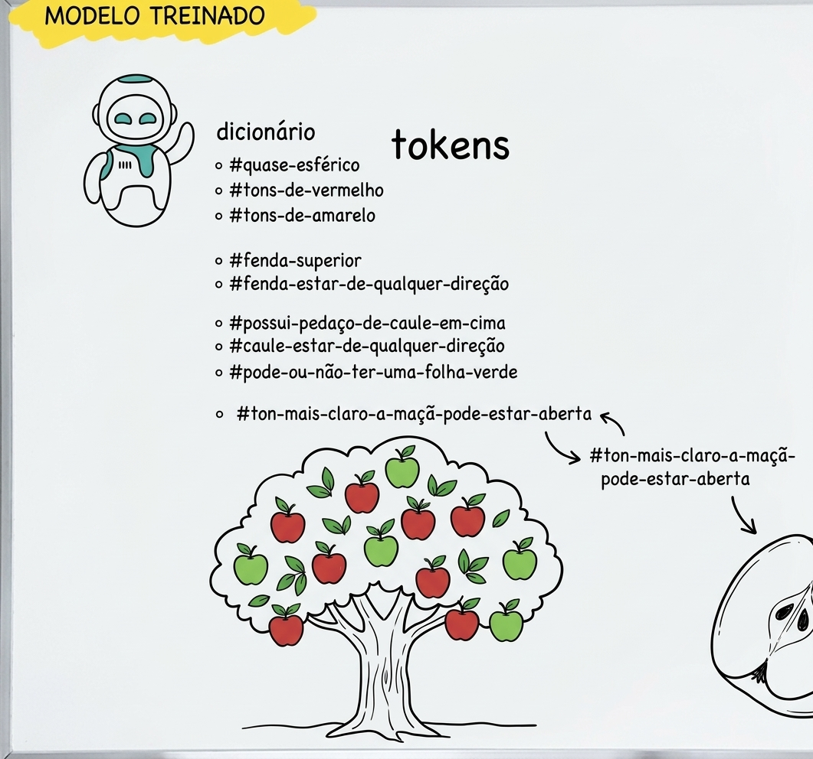
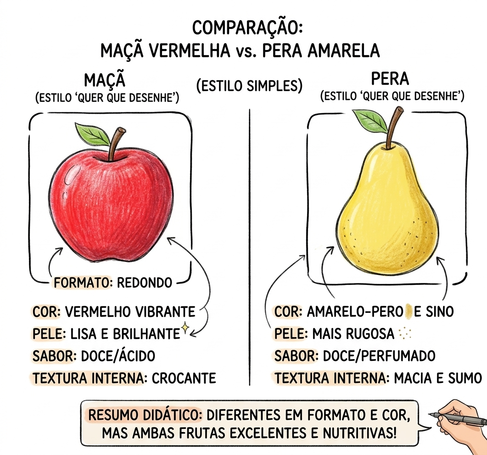
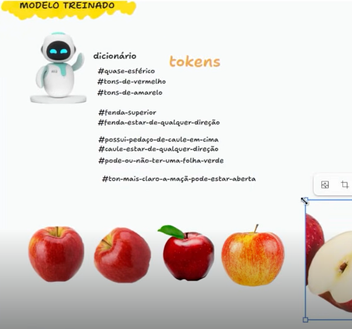

# IA: como um modelo aprende, tokens e diferenciação de conceitos

Este guia explica como um modelo de IA aprende a reconhecer objetos a partir de exemplos, o que são os *tokens* (características) e por que é preciso mostrar contrastes, como maçã e pera. No fim, trata de por que as IAs às vezes alucinam, ou seja, produzem respostas sem base na realidade.

## Sumário

1. [Modelo treinado e tokens](#modelo-treinado-e-tokens)
2. [Diferenciando conceitos: maçã x pera](#diferenciando-conceitos-maçã-x-pera)
3. [Do dado ao raciocínio: as fases do treinamento](#do-dado-ao-raciocínio-as-fases-do-treinamento)
   1. [Passo 1: conceitos base](#passo-1-conceitos-base)
   2. [Passo 2: aprendizado estatístico](#passo-2-aprendizado-estatístico)
   3. [Passo 3: reforço humano (RLHF)](#passo-3-reforço-humano-rlhf)
4. [Por que as IAs alucinam](#por-que-as-ias-alucinam)
   1. [Mitigação](#mitigação)
5. [Resumo](#resumo)

## Modelo treinado e tokens

Um **modelo treinado** é um sistema que aprendeu, a partir de muitos exemplos, a associar características (chamadas de **tokens**) a objetos. Em vez de receber uma regra escrita para cada caso, ele descobre sozinho quais características costumam aparecer juntas.

### Exemplo cotidiano

Imagine que você organiza a fruteira de casa. Você não decora uma foto de cada fruta. Você observa e anota características: "redonda", "vermelha", "tem talo", "tem folha". Quando chega uma fruta nova, você compara essas características e decide o que ela é.

### Exemplo técnico

O quadro abaixo mostra o "dicionário" de tokens de um modelo treinado. Cada marcação, como `#quase-esférico`, `#tons-de-vermelho`, `#fenda-superior` ou `#possui-pedaço-de-caule-em-cima`, representa uma propriedade extraída dos exemplos de maçã.

*Quadro do modelo treinado: o dicionário de tokens e exemplos de maçã, inteira e cortada.*

> **Ponto importante:** o modelo não guarda uma imagem de maçã. Ele guarda um padrão de características. Por isso, uma maçã nova, com outra cor ou outro ângulo, ainda pode ser reconhecida.

## Diferenciando conceitos: maçã x pera

Para o modelo saber que algo é uma maçã, ele também precisa conhecer o que **não** é uma maçã. Sem esse contraste, dois objetos parecidos podem ficar com características muito próximas e ser confundidos.

### Exemplo cotidiano

Uma criança que nunca viu uma pera pode chamá-la de maçã, porque ambas são frutas redondas. Só ao ver as duas lado a lado ela percebe a diferença do formato e da cor.

### Comparativo

*Imagem gerada por IA (Gemini), usada como material didático.*

| Característica | Maçã | Pera |
|---|---|---|
| Formato | Redondo | Abaulado na parte superior, afinando para o talo |
| Cor | Vermelho vibrante | Amarelo |
| Pele | Lisa e brilhante | Mais rugosa |
| Sabor | Doce/ácido | Doce/perfumado |
| Textura interna | Crocante | Macia e suculenta |

## Do dado ao raciocínio: as fases do treinamento

Para construir um sistema inteligente, seja um modelo de linguagem (LLM) ou um modelo de visão computacional que identifica maçãs boas em uma árvore, o treinamento passa por três fases principais.

### Passo 1: conceitos base

Antes de classificar o estado de uma maçã, o modelo precisa ser exposto a exemplos amplos, incluindo objetos parecidos. Cada objeto é convertido em **embeddings**, que são vetores numéricos com muitas dimensões. Sem dados de contraste, como maçã versus pera, os vetores de objetos diferentes podem se sobrepor e gerar erros de classificação.

### Passo 2: aprendizado estatístico

Modelos de *Deep Learning* usam redes neurais com várias **camadas ocultas**. Diferente do Machine Learning clássico, em que o programador escreve as regras, aqui a própria rede descobre as características. Cada grupo de camadas aprende algo diferente:

- **Primeiras camadas:** detectam bordas, cores e texturas.
- **Camadas intermediárias:** combinam esses traços em partes, como o talo e a curvatura.
- **Camadas profundas:** consolidam o conceito abstrato da fruta.

Por isso, o modelo consegue reconhecer uma maçã mesmo quando ela muda de cor, de formato ou de posição. As variações abaixo mostram esse aprendizado: as maçãs são diferentes entre si, mas todas convergem para o mesmo conceito.

*Captura de tela de um vídeo (fonte original não informada). Mostra exemplos variados de maçã reconhecidos como o mesmo conceito.*

### Passo 3: reforço humano (RLHF)

Em casos difíceis, como uma maçã inclinada, parcialmente escondida por folhas ou com cor atípica, a previsão do modelo pode falhar. O **RLHF** (*Reinforcement Learning from Human Feedback*, ou aprendizado por reforço com feedback humano) funciona como um professor que corrige a lição:

1. O modelo faz uma previsão incerta.
2. A pessoa avalia o resultado: confirma se estiver certo ou corrige o rótulo se estiver errado.
3. O algoritmo ajusta os pesos internos e refina o dicionário de tokens. Por exemplo, a fenda superior passa a ser reconhecida em qualquer direção.

## Por que as IAs alucinam

Uma **alucinação** acontece quando o modelo produz uma resposta convincente, mas sem base na realidade. Isso não é um defeito isolado: vem da forma como o modelo funciona.

### Exemplo cotidiano

Imagine uma prova em que você não sabe a resposta, mas escreve algo que soa correto, com as palavras certas e a estrutura de uma boa resposta. A frase fica bonita, mas pode estar errada. Um modelo de linguagem faz algo parecido quando não tem informação suficiente.

### Por que isso acontece

Os modelos de linguagem (LLMs) calculam a probabilidade do próximo *token* com base em bilhões de parâmetros. Eles navegam por um grande espaço de correlações estatísticas. Quando o contexto é ambíguo, escasso ou contraditório, o modelo pode perder a ligação com fatos reais e seguir o caminho de maior probabilidade, mesmo sem embasamento.

O mesmo vale para imagens: um modelo de visão pode "enxergar" uma maçã onde há apenas uma folha deformada.

### Mitigação

| Técnica | Como ajuda |
|---|---|
| RAG (*Retrieval-Augmented Generation*, ou geração aumentada por recuperação) | Consulta bases verificadas antes de responder |
| RLHF | Usa correções humanas para reduzir respostas sem base |

Essas técnicas funcionam como corrimãos: obrigam o modelo a se apoiar em fontes confiáveis, em vez de depender só de probabilidade.

## Resumo

| Conceito | O que é | Exemplo da fruteira |
|---|---|---|
| Modelo treinado | Sistema que aprendeu a partir de exemplos | Você aprendeu a reconhecer frutas olhando muitas delas |
| Token | Característica extraída (ex.: `#tons-de-vermelho`) | "Vermelha", "redonda", "tem talo" |
| Contraste | Exemplos de objetos parecidos, mas diferentes | Maçã ao lado da pera |
| Camadas ocultas | Níveis que vão de traços simples a conceitos | Da borda ao formato da fruta |
| RLHF | Correção humana dos erros do modelo | Alguém corrige: "isso é pera, não maçã" |
| Alucinação | Resposta convincente sem base na realidade | A prova em que se escreve algo que soa certo, mas está errado |